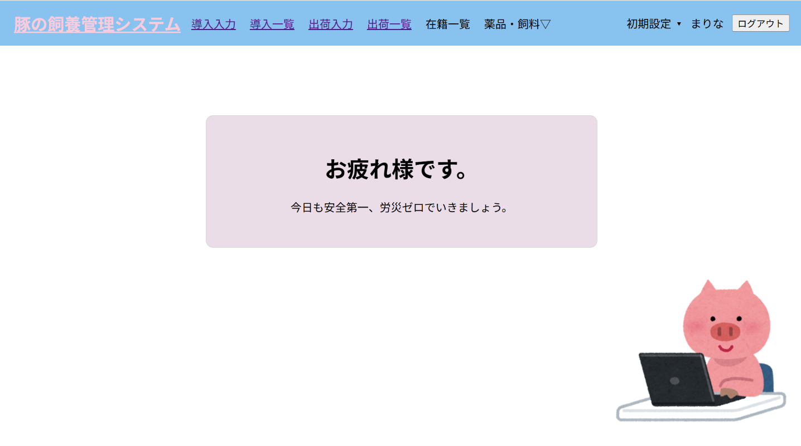
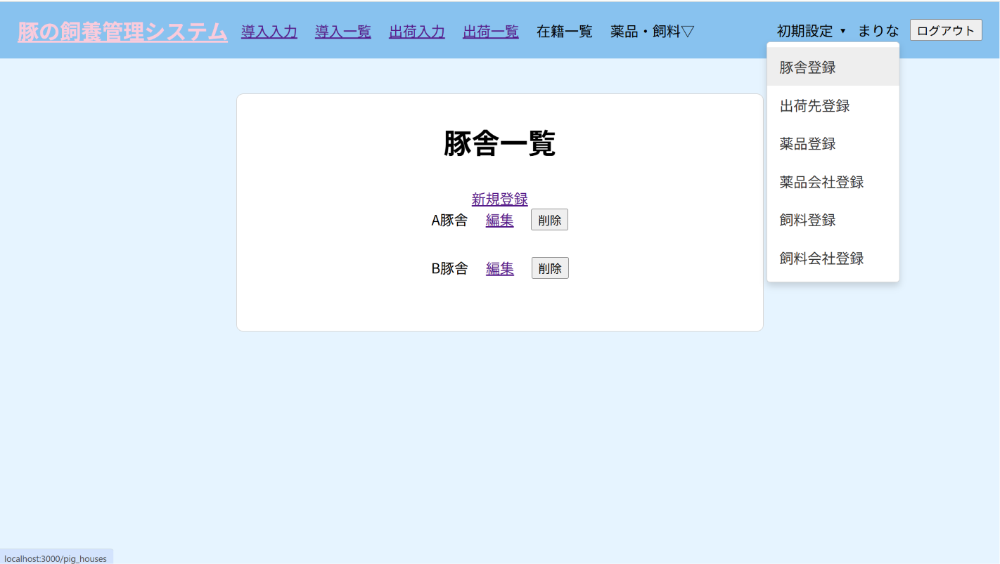
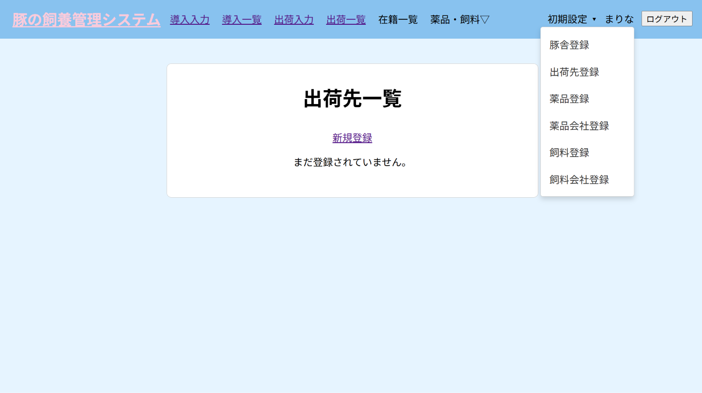
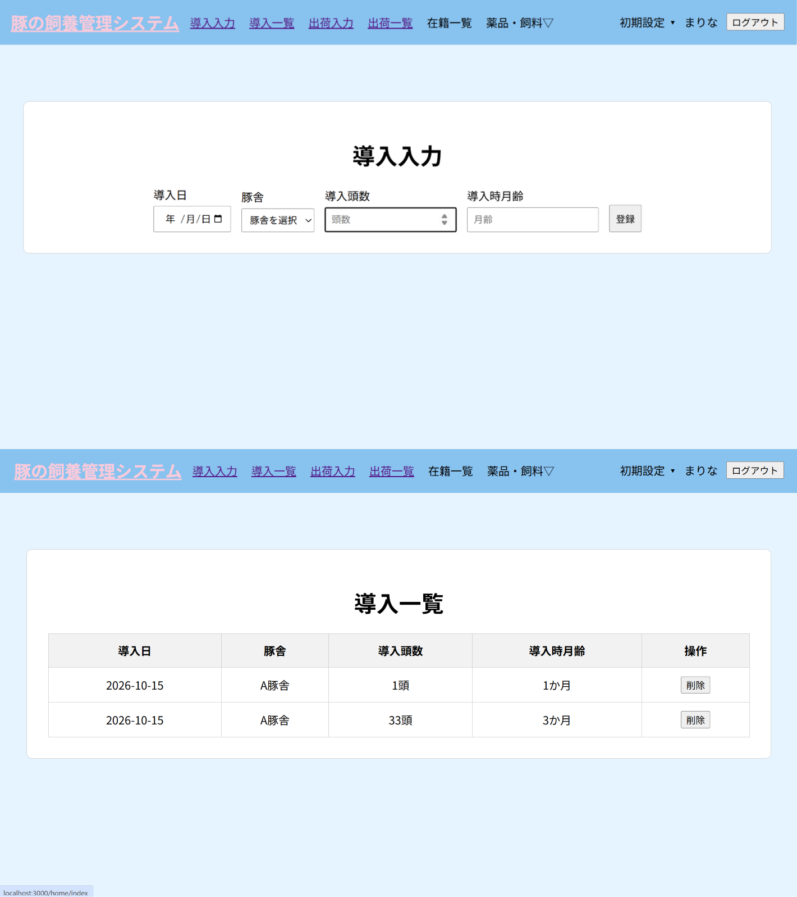
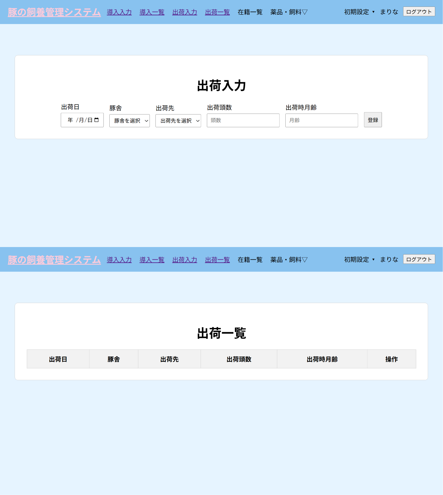
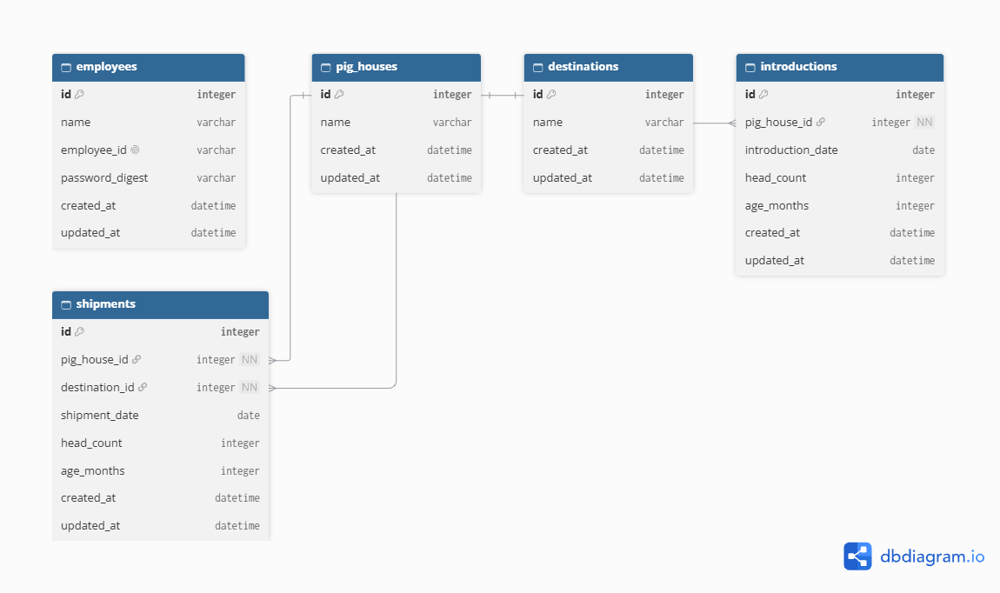

# 豚の飼養管理システム

## アプリの概要

農業従事者をはじめ、現場で働く人の入力ミスを減らし、日々の業務記録を正確に管理することを目指したWebアプリケーションです。

養豚場の従業員向けに、豚の導入・出荷情報を記録・管理するために作りました。

### メイン画面

飼養管理に関する各機能への入口となる画面です。

ほかのページからでも、ヘッダーの「豚の飼養管理システム」をクリックするとメイン画面に戻れます。

ヘッダーメニューをクリックすると、それぞれの入力画面や一覧画面に移動できます。

### 豚舎登録・一覧画面

豚舎の情報を登録し、導入・出荷入力で使用する豚舎を管理します。

画面右上の「初期設定」メニューから「豚舎登録」をクリックすると、豚舎の登録画面に移動できます。

豚舎が登録されている場合、一覧に登録済みの豚舎が表示されます。

### 出荷先登録・一覧画面

出荷先を登録し、出荷入力で使用する出荷先を管理します。

出荷先が登録されていない場合、一覧は空欄で表示されます。

出荷先を登録すると、登録した内容が一覧に表示されます。

### 導入入力・一覧画面

豚の導入日、豚舎、導入頭数、導入時月齢を入力して、導入情報を記録します。

### 出荷入力・一覧画面

出荷日、豚舎、出荷先、出荷頭数、出荷時月齢を入力して、出荷情報を記録します。

## なぜこれを作ったか

養豚場で働いていた際、既存の養豚管理システムは操作が分かりづらく、入力ミスにつながる課題があると感じました。

例えば、2700年のような遠い未来の日付でも入力できてしまい、誤って登録したデータを探すのに苦労した経験があります。

こうした経験から、現場で働く人が迷わず操作でき、入力ミスを防ぎやすい飼養管理システムを作りたいと考え、開発しました。

## 工夫したところ

生産者が迷わず操作できるよう、画面構成をシンプルにしました。

豚舎や出荷先などの登録情報を入力フォームの選択肢に利用することで、入力の手間やミスを減らせるよう工夫しました。

豚舎や出荷先の登録内容に合わせて一覧を表示し、未登録の場合は登録されていないことが分かるようにしました。

### 日付入力の制限

導入日や出荷日などの日付は、当月の日付のみ入力できるようにしました。

月次決算の締め後に、先月の実績をさかのぼって入力することを防ぎ、

月ごとの生産実績や成績の正確性を保つためです。入力ミスや不正な実績操作を防ぎ、

信頼できるデータ管理を目指しました。

## 未実装の機能

・薬品の入庫・使用・廃棄記録や、飼料の使用量を管理する機能

・個人のパスワード変更機能

・従業員の削除機能

上記の機能を実装したかったのですが、今回の開発では未実装となっています。

## ER図

